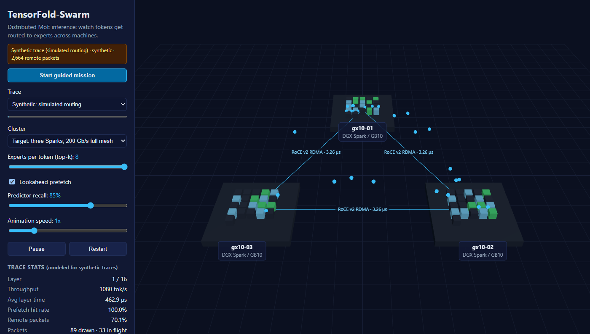

# TensorFold-Swarm

[](https://github.com/AIForGames2026/DistributedMoEEngine/actions/workflows/ci.yml)
[](LICENSE)

Run AI models too big for one machine across a small cluster of NVIDIA DGX Sparks. TensorFold-Swarm gives each machine a share of a Mixture-of-Experts model and sends only the tokens between them, over RDMA or TCP, with no Python at runtime.

**[Try the simulator in your browser](https://aiforgames2026.github.io/DistributedMoEEngine/)**: about 3 minutes, nothing to install.

[](https://aiforgames2026.github.io/DistributedMoEEngine/)

**Status: alpha.** OLMoE-1B-7B runs split across two processes and matches Hugging Face's output. It processes whole prompts and can't generate text yet.

## Build

**Linux or WSL2 (Ubuntu 24.04):**

```bash
git clone https://github.com/AIForGames2026/DistributedMoEEngine.git
cd DistributedMoEEngine
sudo apt install liburing-dev # io_uring, for reading model files
bash tools/setup/install-zig.sh # Zig 0.17.0 in ~/tools/zig, no sudo
export PATH="$HOME/tools/zig:$PATH"
zig build install -Doptimize=ReleaseFast
```

**Windows 11:** in PowerShell, from the repo root. It installs Zig if needed and builds a subset of the engine.

```powershell
.\build.ps1
```

Prefer not to build? [Releases](https://github.com/AIForGames2026/DistributedMoEEngine/releases) has binaries, each with a SHA-256 checksum.

## Run

Split a tiny model across two processes and check the output against PyTorch. It ends with `PASS`.

```bash
zig-out/bin/dispatch shm --moe # Windows: .\zig-out\bin\dispatch.exe shm --moe
```

Or across two machines, starting the first one first:

```bash
zig-out/bin/dispatch expert --port 7470 --moe # first machine
zig-out/bin/dispatch router --host <first machine's IP> --port 7470 --moe # second machine
```

Run the browser inspector locally (needs [Node.js 22](https://nodejs.org)):

```bash
cd web
npm ci
npm run dev
```

To run the real 7 GB model, over RDMA or on a GPU, see [Building and running everything](docs/BUILDING.md).

## Documentation

- [Building and running everything](docs/BUILDING.md): every program, GPU and RDMA builds, benchmarks
- [Project overview](docs/PROJECT.md): architecture, hardware, team, workflow
- [Technical pitch](docs/PITCH.md), [wire format](docs/wire-format.md), [telemetry schema](docs/telemetry-schema.md)
- [Benchmark results](bench/) and the [test plan](TestPlan.md)
- [Plan](Plan.md) and [project board](https://github.com/orgs/AIForGames2026/projects/3)

<details>
<summary><b>Release notes (Alpha)</b></summary>

Played through on the live site from a second machine, a laptop separate from the build desktop (Nov 5).

Changed after the Nov 8 deadline: on Nov 10, a "Desktop + laptop (RTX 3060), Tailscale" cluster option and its real result were added to the inspector. The guided mission is unchanged.

**In this build**
- Guided mission on first load: intro, three experiments with check questions, final challenge, report card, Play again, and Exit.
- The full inspector, with three clusters (including the direct TCP link measured this week), the stress trace, and loading your own trace file. It opens directly with `?explore=1`.
- A panel of results recorded on the real hardware, kept separate from the simulation and linked to the raw data.
- Engine, not part of the test session: RoCE v2 RDMA transport, GGUF and NVFP4 expert loader, and OLMoE-1B-7B split across two processes on CPU or CUDA, matching Hugging Face's output ([`bench/`](bench/)).

**Not in this build**
- No live connection to the engine: everything on the page is simulated or recorded. Traces recorded from the engine arrive with TASK-16.
- No token generation yet: the engine processes whole prompts (TASK-24).
- No lookahead router, tracker, or miss handling yet (Beta).
- The operator dashboard is post-v1 ([TASK-25](Plan.md#task-25-operator-dashboard)).

**Known bugs and limits**
- Simulated speeds assume both machines compute at full GPU speed, so they run higher than the real CPU results the report card quotes. The simulation also leaves out the direct link's bandwidth limit.
- Throughput shows in the panel before you press Run, since it comes from the trace, so the challenge can be solved without running it.
- Phones work, but the card and controls compete for a small screen. A desktop browser is recommended.
- Copy can fall back to "Press Ctrl+C" if the browser blocks clipboard access; the line is selected for you.
- Engine, off the main path: one unexplained GPU failure in 16 runs on `gx10-03` (see [`bench/olmoe/2026-11-05.md`](bench/olmoe/2026-11-05.md)), and the direct TCP link only works with the Spark connecting to the desktop.

Engine binaries are not part of this slice and classmates are not asked to run any. Operators can build from source or download them from [GitHub Releases](https://github.com/AIForGames2026/DistributedMoEEngine/releases), where each one has a published SHA-256 to verify.

</details>

<details>
<summary><b>Deploying the website</b></summary>

The site is hosted on GitHub Pages (the Dec 6 host), and any member with write access can redeploy:

1. Check it locally, then play through the mission:

   ```bash
   cd web
   npm ci
   npm test
   npm run build
   npm run preview
   ```

2. Push to `main`. Any change under `web/` or to `.github/workflows/pages.yml` starts the [Pages workflow](https://github.com/AIForGames2026/DistributedMoEEngine/actions/workflows/pages.yml), which builds the site, fails if the bundle contains an executable or installer, and publishes it.
3. To redeploy with no code change, use **Run workflow** on that page, or run:

   ```bash
   gh workflow run pages.yml --ref main
   ```

4. Wait for the workflow to pass, then open https://aiforgames2026.github.io/DistributedMoEEngine/ in a private window, ideally on another machine, and play through the mission with no console errors.
5. First-time setup only, on a fork: under **Settings > Pages**, set **Source** to **GitHub Actions**.

During a test window, push only fixes the session needs, and list each one in the [release notes](#release-notes).

</details>

## License

[GPL-3.0-or-later](LICENSE).
