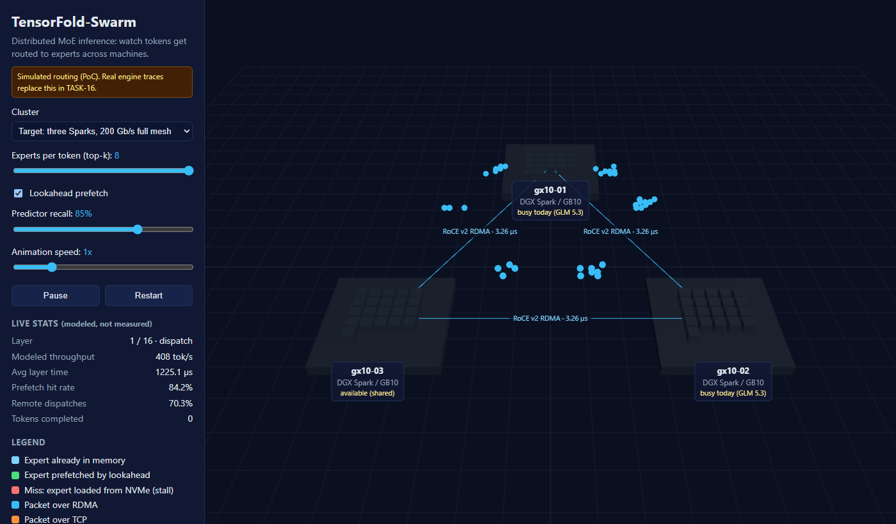

# TensorFold-Swarm (Distributed MoE Inference Engine)

[](LICENSE)
[](https://github.com/AIForGames2026/DistributedMoEEngine/actions/workflows/ci.yml)
[](https://aiforgames2026.github.io/DistributedMoEEngine/)

> **Status:** PoC complete, released as [`v0.1.0-poc`](https://github.com/AIForGames2026/DistributedMoEEngine/releases/tag/v0.1.0-poc) on Oct 27, 2026. Next: Alpha (due Nov 8, 2026).
> **Live demo:** https://aiforgames2026.github.io/DistributedMoEEngine/
> **Project board:** https://github.com/orgs/AIForGames2026/projects/3

## Pitch

TensorFold-Swarm turns a cluster of NVIDIA GB10 desktop nodes into one inference engine for frontier-scale sparse Mixture-of-Experts models. Instead of copying weights around, it pins each expert to a node and moves only the tokens: a Zig/C engine core with no Python runtime sends token hidden states node to node over zero-copy RoCE v2 RDMA, straight into the destination's LPDDR5X memory. A lightweight lookahead router predicts which experts the next layers will need, so network transfers and `io_uring` NVMe expert reads start before the layer that needs them, hidden behind the compute already running. Everything the swarm does can be watched in an in-browser WebGL inspector, with nothing to install.

## Proof of Concept

[](https://aiforgames2026.github.io/DistributedMoEEngine/)

**Core mechanic: routing tokens to experts across machines.** The WebGL inspector ([open it live](https://aiforgames2026.github.io/DistributedMoEEngine/)) animates a Mixture-of-Experts model (OLMoE-1B-7B shape: 16 layers, 64 experts, top-8) running across the real lab topology:

- Each batch of tokens goes through a top-k gate, layer by layer. Packets fly to whichever node owns each chosen expert (**dispatch**), the experts light up (**compute**), and the results fly back (**combine**).
- Expert colors show what the lookahead router achieved: already in memory, prefetched in time, or a miss that stalls on NVMe.
- Everything on screen is played from a **telemetry trace** ([schema v0](docs/telemetry-schema.md)), the same format the engine will record in TASK-16. Pick a trace: one generated in the browser from simulated routing (switch between the three-Spark cluster and today's Spark-plus-desktop setup, and adjust top-k and predictor recall), a 10,000-packet stress test, or a `.json` trace file of your own.
- Timing in synthetic traces uses **measured** numbers: 3.26 µs RDMA per 7,552-byte packet, 7.2 GB/s NVMe reads, and the Tailscale relay's 33 ms round trip ([`bench/`](bench/)). The panel lists every input and its source.

Engine side: the C ABI and reference GEMM kernels, a token transport (shared memory and TCP, verified desktop to Spark), the io_uring expert reader (7.2 GB/s, matching `fio`), and a CPU MoE reference that matches PyTorch golden outputs. CI runs the unit tests and cross-compiles for the Sparks (aarch64).

## Links

- [Design Document & Plan](Plan.md): scope, tasks, milestones, risks, and verified hardware constraints
- [Technical Pitch](docs/PITCH.md)
- [Project Board](https://github.com/orgs/AIForGames2026/projects/3) and [Milestones](https://github.com/AIForGames2026/DistributedMoEEngine/milestones)
- [Platform probe: gx10-03](bench/platform/gx10-03-2026-10-26.md)
- [Research reports](Research/)

## Team Roles & Members

This is a one-person project built with an AI pair programmer. Luke holds all four roles and owns every task on the board; the role split shows which hat each part of the work needs.

| Role | Member | Owns |
|---|---|---|
| **Lead Architect** | Luke Hinojosa | Engine core, scheduling loop, gating, lookahead router, miss handling, whitepaper |
| **Network/RDMA Engineer** | Luke Hinojosa | Transport layer, RoCE v2 verbs, swarm tracker integration, multi-node testing |
| **CUDA/Kernel Engineer** | Luke Hinojosa | FP4 GEMM kernels, `io_uring` storage path, expert loader, KV tiering, decompression, platform probe |
| **WebGL Frontend Developer** | Luke Hinojosa | WebGL inspector, telemetry replay, GitHub Pages showcase |
| *AI pair programmer* | Claude (Anthropic) | Code drafts, tests, reviews, and documentation, all reviewed and committed by Luke |

## Target Platform

| Component | Target |
|---|---|
| **Compute node** | NVIDIA DGX Spark (GB10 Grace Blackwell): 20-core Arm Grace CPU, Blackwell GPU (compute capability 12.1, `sm_121`), 128 GB unified LPDDR5X (~273 GB/s). The project starts on one shared Spark, with up to three as they free up. |
| **Dev workstation** | RTX 5070 Ti (16 GB, compute capability 12.0), i7-12700K, 64 GB DDR4, running WSL2; also serves as a second node in cross-machine TCP runs |
| **Interconnect** | NVIDIA ConnectX-7, RoCE v2, 200 Gb/s; the three Sparks are direct-cabled in a full mesh |
| **Storage** | PCIe Gen 4 x4 NVMe on `gx10-03`, read through `io_uring` + `O_DIRECT` |
| **Weight formats** | NVFP4, MXFP4, Q8_0 (GGUF) |
| **OS** | Linux (aarch64); the engine runs in user space with no Python runtime |
| **Web inspector** | Any current browser with WebGL 2.0 (Chrome, Firefox, Edge, Safari) |

## Planned Publish Locations

- **GitHub Pages** (primary): the in-browser WebGL inspector, deployed by CI on every push to `main`.
- **GitHub Releases**: tagged source releases (`v0.1.0-poc` to `v1.0.0`), operator builds for GB10, and benchmark data bundles.

## Running It

### Web inspector

Requires Node.js 22 or newer.

```bash
cd web && npm install && npm run dev
```

Then open the URL Vite prints (usually http://localhost:5173). `npm run build` writes the static site to `web/dist/`.

### Engine

Requires Zig 0.17.0 (pinned in `.zig-version`) on Linux or WSL2. One-time setup on WSL2 (Ubuntu 24.04), from the repo root:

```bash
bash tools/setup/install-zig.sh
```

```bash
sudo bash tools/setup/wsl2-packages.sh
```

The first installs Zig into `~/tools/zig` (checksum verified, no sudo). The second installs liburing, rdma-core, fio, and the CUDA 13.0 toolkit from NVIDIA's WSL repository (the GPU driver comes from Windows).

```bash
zig build test --summary all
```

Toolchain gate (links liburing and the CUDA runtime, then calls both). Add `-During=<prefix>` if liburing is not in the system paths, as on the Sparks:

```bash
zig build gate
```

io_uring expert reader (TASK-03): unit test, then a throughput run against a 1 GiB pattern file (delete it afterward):

```bash
zig build io-test
```

```bash
zig build io-bench -Doptimize=ReleaseFast && zig-out/bin/uring_bench mk /tmp/expert.bin 1024 && zig-out/bin/uring_bench read /tmp/expert.bin --bs 256 --qd 16 --verify
```

Reference harness (TASK-06, testing only): regenerates `tests/golden/moe_tiny.tfref` from a fixed seed, or checks that the committed file still matches. Needs PyTorch (CPU build), for example in a virtual environment:

```bash
python3 -m venv ~/tools/ref-venv && ~/tools/ref-venv/bin/pip install -r tools/ref/requirements.txt --index-url https://download.pytorch.org/whl/cpu
```

```bash
~/tools/ref-venv/bin/python tools/ref/ref_moe.py --check
```

Two-process dispatch and combine check (TASK-02), over shared memory, or over TCP between two machines (start the expert first):

```bash
zig build install -Doptimize=ReleaseFast && zig-out/bin/dispatch shm
```

```bash
zig-out/bin/dispatch expert --port 7470
```

```bash
zig-out/bin/dispatch router --host <expert IPv4> --port 7470
```

```bash
zig build run
```

Cross-compile for the DGX Sparks:

```bash
zig build -Dtarget=aarch64-linux-gnu
```

### Lab machine access

Lab machines are reached over Tailscale with SSH keys, never passwords stored in the repo. One-time setup from Git Bash or WSL2:

```bash
ssh-keygen -t ed25519 -f ~/.ssh/spark_ed25519 -C "tensorfold-swarm"
```

```bash
ssh-copy-id -i ~/.ssh/spark_ed25519.pub admin@gx10-03
```

Then add a host entry to `~/.ssh/config`:

```
Host gx10-03
    User admin
    IdentityFile ~/.ssh/spark_ed25519
```

The `admin` account is shared, so all project files on a Spark live in `~/lukehinojosa/` and are activated with `source ~/lukehinojosa/env.sh`.

## Architecture at a Glance

| Layer | Subsystem | Technology |
|---|---|---|
| 4 | Swarm orchestration (node registry, health, expert ownership) | Lumabri / Colibri pure-C tracker daemon |
| 3 | Scheduling, token batching, lookahead loop, arena allocation | TensorFold engine core (Zig) |
| 2 | Token transport and weight streaming | libibverbs (RoCE v2), liburing, nvCOMP |
| 1 | Expert execution kernels | Blackwell FP4 Tensor Core kernels (CUDA / PTX) |

Four bottlenecks, four answers:

1. **All-to-all network choke**: one-sided RDMA WRITE-with-immediate into pre-registered slot rings, with receiver-granted credits.
2. **Routing dependency stalls**: a lookahead router predicts expert sets 1 to 2 layers ahead; the native router stays authoritative, so predictions affect only prefetching.
3. **PCIe streaming bottleneck**: fine-grained expert reads via `io_uring` fixed buffers, with optional lossless compression only where measurements show a win.
4. **Memory contention**: tiered KV cache keeping attention sink and recent tokens in LPDDR5X and offloading middle context to NVMe.

Design details and verified hardware limits are in [Plan.md, Section 7](Plan.md#7-risks-research-verified-constraints--fallbacks).

## Web Delivery & Safety

- The demo is **100% WebGL 2.0 + JavaScript in the browser sandbox**, served as static files from GitHub Pages.
- **Visitors never download** `.exe`, `.dmg`, `.pkg`, `.msi`, or install scripts. The Pages workflow fails the deploy if any such file appears in the bundle.
- The page sets a Content-Security-Policy and loads no third-party scripts.
- The hosted demo uses simulated or recorded data only. Live telemetry (TASK-16b) would connect only to an operator-supplied `wss://` endpoint and is never enabled by default.

## Repository Layout

```
build.zig            Zig build (run, test); .zig-version pins Zig 0.17.0
include/             Public C ABI (tensorfold.h, tf_wire.h)
csrc/                C sources behind the ABI (io_uring reader, CRC32C; verbs code lands here)
src/                 Zig engine core (entry point, arena, wire format, transport, reference GEMM)
tests/               Plain C tests of the public ABI; golden/ holds PyTorch reference outputs
tools/probe/         Platform probe (probe.py writes bench/platform/<host>-<date>.json)
tools/ref/           PyTorch reference harness for the golden files (testing only)
tools/setup/         Zig installer and WSL2 package setup
web/                 WebGL inspector (Vite + Three.js) and trace generator
bench/platform/      Hardware probe results
docs/                Pitch, wire format, telemetry schema, images, and (later) whitepaper
Research/            Source research reports
.github/workflows/   CI (engine tests, web build) and GitHub Pages deploy
```

## Workflow

Work is tracked on the [project board](https://github.com/orgs/AIForGames2026/projects/3) with columns `Backlog`, `To Do`, `In Progress`, `Review`, `Done`. Every task has a priority label (`must`, `should`, `could`), an area label (`code`, `architecture`, `benchmarking`, `webgl`, `docs`), a milestone, and, if it is in a cut line, a `cut-1` or `cut-2` tag. See [Plan.md, Sections 4 and 5](Plan.md#4-scope-tiers--cut-lines) for scope tiers, cut lines, and board rules.

## Acknowledgements & References

Builds on ideas from TensorFold, Colibri / Lumabri, Strata, Director, SpecPrefetch, ProMoE, fabric-lib, and DeepEP. Full citations are in [`Research/`](Research/).

## License

TensorFold-Swarm is free software: you can redistribute it and/or modify it under the terms of the GNU General Public License as published by the Free Software Foundation, either version 3 of the License, or (at your option) any later version (`GPL-3.0-or-later`). See [LICENSE](LICENSE).

Before the first binary release, a GPLv3 section 7 additional permission will be added for linking with NVIDIA's proprietary CUDA and nvCOMP libraries (tracked as risk R8 in [Plan.md](Plan.md)).
