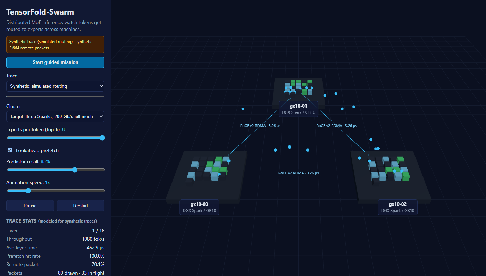

# TensorFold-Swarm

Run AI models too big for one machine across a small cluster of NVIDIA DGX Sparks. TensorFold-Swarm gives each machine a share of a Mixture-of-Experts model and sends only the tokens between them, over RDMA or TCP, with no Python at runtime.

**[Watch the engine in your browser](https://aiforgames2026.github.io/DistributedMoEEngine/)**: recorded chats and soak runs of the real engine, replayed with each token's experts lit on the machine that ran them. Nothing to install. The [simulator with its guided mission](https://aiforgames2026.github.io/DistributedMoEEngine/inspector.html) is a second tab.

**Status: beta.** Mixture-of-Experts models from OLMoE-1B-7B up to the 181 GB GLM-5.3-Flash run in one process or split across machines over RDMA, TCP, or shared memory, generate text matching Hugging Face's, and serve an OpenAI-compatible chat API. See the [release notes](#release-notes).

## Build

**Linux or WSL2 (Ubuntu 24.04):**

1. Clone the repo and `cd` into it.
2. Install io_uring: `sudo apt install liburing-dev`
3. Install Zig 0.17.0 (no sudo): `bash tools/setup/install-zig.sh && export PATH="$HOME/tools/zig:$PATH"`
4. Build: `zig build install -Doptimize=ReleaseFast`

**Windows 11:** in PowerShell at the repo root, run `.\build.ps1` (it installs Zig if needed; add `-Gpu` for CUDA, or `-Installer` for the installer).

Prefer not to build? [Releases](https://github.com/AIForGames2026/DistributedMoEEngine/releases) has binaries, each with a SHA-256 checksum, and the Windows installer.

## Run

- **Quick check:** `zig-out/bin/dispatch shm --moe` splits a tiny model across two processes and ends with `PASS`.
- **Two machines:** run `zig-out/bin/dispatch expert --port 7470 --moe` on the first, then `zig-out/bin/dispatch router --host <first machine's IP> --port 7470 --moe` on the second.
- **Website locally:** in `web/`, run `npm ci && npm run build && npm run preview` (needs [Node.js 22](https://nodejs.org)).
- **The real 7 GB model, RDMA or GPU:** see [Building and running everything](docs/BUILDING.md).

### Operator dashboard

Run a model across several machines from one page.

**Windows:**

1. Run `TFSwarm-Setup-<version>.exe` from [Releases](https://github.com/AIForGames2026/DistributedMoEEngine/releases), pick CUDA or CPU, and start TFSwarm.
2. On the setup page, choose "Host the dashboard" or "Join a dashboard" and pick your models folder.
3. To join, paste the node secret from the dashboard's Settings ("Copy node secret").
4. On the dashboard, approve each joined PC, tick it under Model, and press Load.

Click the tray icon to reopen the dashboard; its menu has Settings, the admin token, logs, updates and Quit. Uninstall from Windows Settings, Apps. From a build, double-click `zig-out\bin\tfswarm-operator.exe` instead of step 1.

**Linux:**

1. On the main machine, run `zig-out/bin/tfswarm dashboard --models ~/models`.
2. Open `http://127.0.0.1:8080/` and sign in with the token in `dashboard.token`.
3. Copy `node.secret` to each other machine and `chmod 600` it.
4. On each, run `zig-out/bin/tfswarm node --dashboard <dashboard IP> --models ~/models --secret-file node.secret`.
5. On the dashboard, approve each machine, tick it under Model, and press Load.

Chat on the page, or point any OpenAI-compatible client at `http://<dashboard>:8080/v1`. The dashboard uses plain HTTP, so keep it on a private network. Every option, and running it from PowerShell, is in [Building and running everything](docs/BUILDING.md).

## Documentation

- [Building and running everything](docs/BUILDING.md): every program, GPU and RDMA builds, benchmarks
- [Project overview](docs/PROJECT.md): architecture, hardware, team, workflow
- [Technical pitch](docs/PITCH.md), [wire format](docs/wire-format.md), [telemetry schema](docs/telemetry-schema.md)
- [Benchmark results](bench/) and the [test plan](TestPlan.md)
- [Plan](Plan.md) and [project board](https://github.com/orgs/AIForGames2026/projects/3)

## Release notes

<b>Beta (<code>v0.3.0-beta</code>, Nov 20)</b>

The website is now the engine itself: recorded chats and runs of the real engine, replayed in the browser, with each token's experts lit on the machine that ran them. Checked on the live site (Nov 20): all nine recordings play with each machine's call count matching the engine's own, and the mission page loads, with no console errors.

**In this build**
- **Generation and chat:** token-by-token generation with a KV cache, matching transformers' `generate()` (TASK-24), and an OpenAI-compatible server with a built-in chat page (TASK-30).
- **The Beta engine features:** a lookahead router that guesses the next layers' experts so they load in time (TASK-11), exact miss handling when a guess is wrong (TASK-14), a swarm tracker that expert processes join and that notices a lost one (TASK-09), a KV cache that spills to NVMe for 128k-token prompts (TASK-12), and expert processes on a CPU (TASK-22) or an RTX 30-series GPU (TASK-26).
- **Beyond the Beta plan:** any number of expert machines (TASK-33); Qwen3-30B-A3B, Qwen3.6, Qwen3.8-Flash-Next, GLM-5.3-Flash, Mixtral, DeepSeek V3 and gpt-oss; every GGUF quant format, tokenizers and chat templates read from the GGUF (TASK-29, 31, 32, 36 to 39); and an operator dashboard (TASK-25).
- **The website:** nine recordings, each with two diagrams at their own speeds (All experts, and One token climbing the layers), a chat that reads like a chat, and a status line with a progress bar for each. Each result links to its raw data in [`bench/`](bench/).

**Changed after Testing Session 1** ([feedback summary](FEEDBACK.md))
- The diagram now explains what it shows, step by step ([#45](https://github.com/AIForGames2026/DistributedMoEEngine/issues/45), [#53](https://github.com/AIForGames2026/DistributedMoEEngine/issues/53)).
- The front page animates the real engine's recorded runs, not a simulation ([#46](https://github.com/AIForGames2026/DistributedMoEEngine/issues/46)).
- It opens on a four-machine run whose reply describes experts correctly, and OLMoE's misleading reply carries a note ([#47](https://github.com/AIForGames2026/DistributedMoEEngine/issues/47)).
- The operator dashboard controls the machines, the router, the models and the API ([#51](https://github.com/AIForGames2026/DistributedMoEEngine/issues/51)).
- The guided mission moved to `inspector.html`, unchanged; its three issues are won't-fix ([#48](https://github.com/AIForGames2026/DistributedMoEEngine/issues/48) to [#50](https://github.com/AIForGames2026/DistributedMoEEngine/issues/50)).

**Content lock (Nov 20).** The site's pages, views and recordings, and the engine's features for v1, are locked at this build. Until v1, changes are fixes, measurements and documents only:
- **Release Candidate (`v0.9.0-rc1`, Nov 29):** the benchmark report and architecture whitepaper (TASK-19), developer documentation and the API freeze (TASK-20), and sharing the project with other developers once the site is final ([#52](https://github.com/AIForGames2026/DistributedMoEEngine/issues/52)).
- **Final (`v1.0.0`, Dec 6):** the public release and docs freeze.
- Post-v1 work in progress (GLM-5.3-Flash's 128k prompt over two Sparks, TASK-32) adds results to `bench/`, not new site content.
- **Amended Nov 20:** the native Windows engine (TASK-40) and the native Windows dashboard and node agent (TASK-43), and the Windows tray launcher with settings in the dashboard (TASK-44), are pulled in before v1. They add Windows code; Linux builds and tests are unchanged.

**Not in this build**
- Compressed expert streaming (TASK-13) was cut on Nov 11.
- GLM-5.3-Flash's 128k-token prompt over two Sparks: the first run hung, and a fix for the cause found (a credit deadlock in the transport) is in this build but not yet run on the real model.
- The engine on native Windows (TASK-40), Vulkan (TASK-34) and Metal (TASK-35): Windows runs the two-process check only.
- GPU and RDMA builds are not in the downloads; build them from source ([docs/BUILDING.md](docs/BUILDING.md)).

**Known bugs and limits**
- At 1x, All experts can wait on one layer for a long time where the recording did (16.8 s on the four-machine run's first prompt layer), since it plays at the recorded pace.
- The live view shows only rank 0's expert cache.
- FP8 and BF16 payloads keep every top-1 token but miss the 1e-2 logits target; F32 meets it.
- GLM-5.3-Flash's long-prompt accuracy targets were lowered on Nov 18 after transformers itself, with 1e-6 noise, shared only 97.9% of expert choices with its plain run ([write-up](bench/olmoe/2026-11-17-glm53.md)).
- One run of the unit tests on Nov 20 failed without naming a test, and 24 reruns passed; it is likely a timing-sensitive multi-process test.

<b>Alpha (<code>v0.2.0-alpha</code>, Nov 10)</b>

Played through on the live site from a second machine, a laptop separate from the build desktop (Nov 5).

Changed after the Nov 8 deadline: on Nov 10, a "Desktop + laptop (RTX 3060), Tailscale" cluster option and its real result were added to the inspector. The guided mission is unchanged.

**In this build**
- Guided mission on first load: intro, three experiments with check questions, final challenge, report card, Play again, and Exit.
- The full inspector, with three clusters (including the direct TCP link measured this week), the stress trace, and loading your own trace file. It opens directly with `?explore=1`.
- A panel of results recorded on the real hardware, kept separate from the simulation and linked to the raw data.
- Engine, not part of the test session: RoCE v2 RDMA transport, GGUF and NVFP4 expert loader, and OLMoE-1B-7B split across two processes on CPU or CUDA, matching Hugging Face's output ([`bench/`](bench/)).

**Not in this build**
- No live connection to the engine: everything on the page is simulated or recorded. Traces recorded from the engine arrive with TASK-16.
- No token generation yet: the engine processes whole prompts (TASK-24).
- No lookahead router, tracker, or miss handling yet (Beta).
- The operator dashboard is post-v1 ([TASK-25](Plan.md#task-25-operator-dashboard)).

**Known bugs and limits**
- Simulated speeds assume both machines compute at full GPU speed, so they run higher than the real CPU results the report card quotes. The simulation also leaves out the direct link's bandwidth limit.
- Throughput shows in the panel before you press Run, since it comes from the trace, so the challenge can be solved without running it.
- Phones work, but the card and controls compete for a small screen. A desktop browser is recommended.
- Copy can fall back to "Press Ctrl+C" if the browser blocks clipboard access; the line is selected for you.
- Engine, off the main path: one unexplained GPU failure in 16 runs on `gx10-03` (see [`bench/olmoe/2026-11-05.md`](bench/olmoe/2026-11-05.md)), and the direct TCP link only works with the Spark connecting to the desktop.

Engine binaries are not part of this slice and classmates are not asked to run any. Operators can build from source or download them from [GitHub Releases](https://github.com/AIForGames2026/DistributedMoEEngine/releases), where each one has a published SHA-256 to verify.

<b>Deploying the website</b>

The site is hosted on GitHub Pages (the Dec 6 host), and any member with write access can redeploy:

1. Check it locally: in `web/`, run `npm ci && npm test && npm run build && npm run preview`.
2. Push to `main`; the [Pages workflow](https://github.com/AIForGames2026/DistributedMoEEngine/actions/workflows/pages.yml) builds, checks and publishes the site.
3. To redeploy with no code change, run `gh workflow run pages.yml --ref main`.
4. When it passes, open the [live site](https://aiforgames2026.github.io/DistributedMoEEngine/) in a private window and replay each recording.
5. On a fork, first set **Settings > Pages > Source** to **GitHub Actions**.

The main page's recordings are listed in `web/showcase.json`. During a test window, push only fixes the session needs, and list each one in the [release notes](#release-notes).

## License

[GPL-3.0-or-later](LICENSE).
